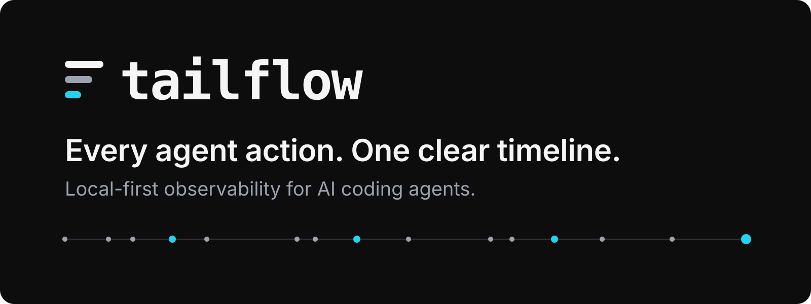
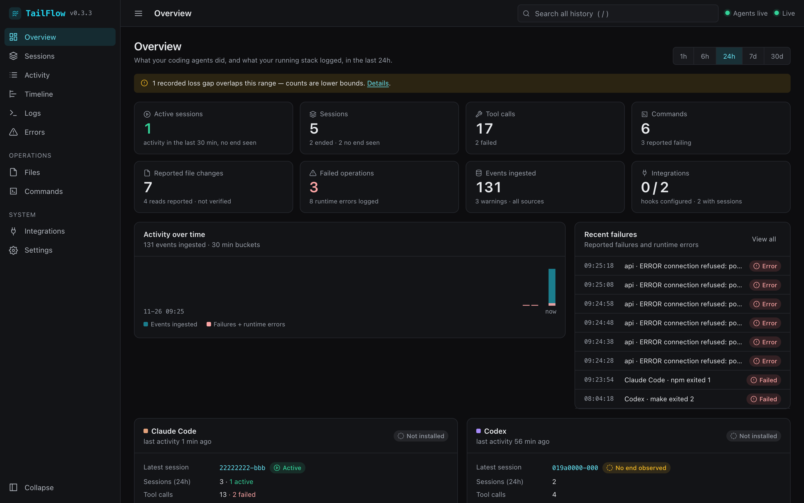
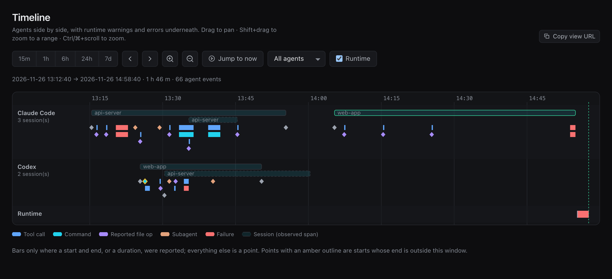

<p align="center">
  
</p>

<p align="center">
  <a href="#what-tailflow-does">Features</a> ·
  <a href="#how-it-works">How It Works</a> ·
  <a href="#quick-start">Quick Start</a> ·
  <a href="#documentation">Documentation</a> ·
  <a href="#roadmap">Roadmap</a>
</p>

<p align="center">
  <a href="https://github.com/thinkgrid-labs/tailflow/releases"></a>
  <a href="https://www.npmjs.com/package/tailflow"></a>
  <a href="https://github.com/thinkgrid-labs/tailflow/actions/workflows/ci.yml"></a>
  
  <a href="LICENSE"></a>
</p>

# TailFlow

**See what your coding agents actually do.**

TailFlow is local-first observability for AI coding agents such as Claude Code
and Codex. It puts two kinds of evidence on one timeline on your machine:

- **What your stack printed**: the output of your dev servers, Docker
  containers and log files, which your agent can query over MCP or a shell
  command to check that a change really works.
- **What your agent did**: sessions, tool calls, commands and file edits, as
  the agent's own hooks report them. For directories you choose, TailFlow
  also records what actually changed on disk and in Git, so you can compare
  the agent's report with independent evidence.

It runs as one small Rust daemon. It needs no account and no cloud service,
and it sends nothing off your machine.

> [!NOTE]
> **Release status.** The latest release is **v0.3.3**. `npm install -g tailflow`
> installs it, and it covers runtime logs, MCP and the shell client. Agent
> capture, the agent dashboard, file and Git evidence, and the authenticated
> local API are merged on `dev` for the upcoming **v0.4.0**, which is not yet
> released. To try them now, [build from source](#try-the-upcoming-v040-from-source).

## Why TailFlow?

Coding agents edit files, run commands and restart services on their own.
Two questions are hard to answer afterwards:

- **Did the change work?** A passing build does not prove the app started,
  reloaded or handled a request. That proof is in runtime output spread over
  terminal tabs, containers and files, which the agent cannot see.
- **What did the agent actually do?** A chat transcript tells you what the
  agent said. It does not give you a searchable record of its commands, the
  files it touched, what failed, or how that lines up with your logs.

TailFlow answers both on your machine, and it says where its answers stop.
Unlike an ordinary log viewer, it labels every record by where it came from
(the agent's report, the filesystem, Git or your stack's output) and never
presents an inference as a fact.

## What TailFlow does

| Capability | What you get | Status |
|---|---|---|
| **One runtime timeline** | stdout/stderr of dev processes, local Docker containers, log files and piped stdin in one ordered stream | v0.3.3 |
| **Agent access over MCP** | Four bounded tools: `list_log_sources`, `get_recent_errors`, `search_logs`, `wait_for_logs` | v0.3.3 |
| **Shell client** | `tailflow-logs` for agents and scripts without MCP, with JSON output and exit codes | v0.3.3 |
| **Error grouping and waits** | Repeated failures collapse into one group with stack-trace context; wait for a rebuild or error instead of polling | v0.3.3 |
| **Terminal UI and guided setup** | `tailflow` TUI; `tailflow init` detects dev scripts, Compose files and log files | v0.3.3 |
| **Durable local history** | SQLite with full-text search, 30-day / 2 GB defaults, secret redaction, and a completeness verdict on every answer | v0.4.0 (upcoming) |
| **Agent capture** | Opt-in Claude Code and Codex hooks record sessions, tool calls, commands and reported file edits; `tailflow sessions` | v0.4.0 (upcoming) |
| **Agent dashboard** | Overview, sessions, activity search, a multi-agent timeline beside runtime errors, files, commands and live logs; agent views update from a live stream | v0.4.0 (upcoming) |
| **File and Git evidence** | Opt-in observation of chosen directories: what changed on disk, and Git worktree snapshots at session start and end, compared with what the agent reported | v0.4.0 (upcoming) |
| **Command outcomes and related evidence** | Builds, tests, lint and type checks with the outcome the agent reported; related events graded in five evidence tiers | v0.4.0 (upcoming) |
| **Authenticated local API** | A per-run token for CLI, MCP and scripts, and a one-time sign-in link for the browser | v0.4.0 (upcoming) |

The [feature guide](docs/features.md) explains each capability and what its
results do and do not prove.

## Dashboard preview

<p align="center">
  
</p>

<p align="center">
  
</p>

<sub>The v0.4.0 dashboard on <code>dev</code>, captured from the synthetic end-to-end fixture: two Claude Code and two Codex sessions (one joined mid-way), failing tests, and a runtime source logging connection errors. No real project data. See the <a href="docs/dashboard.md">dashboard guide</a>.</sub>

## How it works

<p align="center">
  
</p>

1. **Collect.** `tailflow-daemon` follows the sources in `tailflow.toml` or on
   the command line, and nothing else. With hooks installed, the agent's
   hook calls reach it through an owner-only spool directory. With
   `[observe]` set, it also watches the project directories you list.
2. **Process.** Each line gets a timestamp, source and severity. Secrets are
   redacted before anything is displayed or stored. Events go to an in-memory
   buffer and to local SQLite history.
3. **Use.** The dashboard, the HTTP API, `tailflow-mcp` and `tailflow-logs`
   all read from the same daemon, so you and your agent see the same evidence.

The [architecture guide](docs/architecture.md) covers components and the data
path in detail.

## Quick start

### Install the current release (v0.3.3)

Prebuilt binaries cover macOS (ARM64, x64), Linux (ARM64, x64) and Windows
(x64). The npm package needs Node.js 18+ but no Rust toolchain.

```bash
# 1. Install tailflow, tailflow-daemon, tailflow-mcp and tailflow-logs
npm install -g tailflow

# 2. In your project, pick sources and write tailflow.toml
cd your-project
tailflow init

# 3. Start the collector and keep it running
tailflow-daemon
```

Connect Claude Code from another terminal:

```bash
claude mcp add tailflow -- tailflow-mcp
```

Other MCP clients can run `tailflow-mcp` as a stdio server:

```json
{
  "mcpServers": {
    "tailflow": { "command": "tailflow-mcp" }
  }
}
```

Then ask your agent to call `list_log_sources`; it should list your configured
services. For a shell-only check, run `tailflow-logs sources`.

### Try the upcoming v0.4.0 from source

Agent capture, the agent dashboard and file evidence are on `dev`. Building
them needs Rust 1.89+ and Node.js 20+:

```bash
git clone --branch dev https://github.com/thinkgrid-labs/tailflow.git
cd tailflow
(cd web && npm ci && npm run build)   # the daemon embeds the dashboard at build time
cargo install --locked --path crates/tailflow-tui      # tailflow
cargo install --locked --path crates/tailflow-daemon   # tailflow-daemon
cargo install --locked --path crates/tailflow-agent    # tailflow-mcp, tailflow-logs
```

Then, in your project:

```bash
tailflow init                       # once: write tailflow.toml
tailflow agent install claude       # optional: record Claude Code (or: codex)
tailflow-daemon --observe .         # --observe is optional: file and Git evidence
```

The daemon prints a one-time sign-in link for the dashboard
(`http://127.0.0.1:7878`); later, `tailflow-daemon dashboard` opens it with a
fresh link. After a Claude Code session, run `tailflow sessions`. Stop the
daemon with Ctrl+C, and remove the hooks with `tailflow agent uninstall claude`.

The [getting-started guide](docs/getting-started.md) covers configuration,
Docker and file sources, custom ports and troubleshooting.

### Upgrading from 0.3.x

v0.4.0 requires a credential for every API call. `tailflow-mcp` and
`tailflow-logs` from the same release find the token on their own; older
clients get `401` and need upgrading together with the daemon. `curl` and
scripts send `Authorization: Bearer $(tailflow-daemon token)`, and the
browser signs in once with the link the daemon prints. See
[upgrading from 0.3.x](docs/security.md#upgrading-from-03x).

## Supported coding agents

TailFlow works with agents in two directions: the agent can **read** your
stack's output, and, with opt-in hooks, TailFlow can **record** the agent's
own actions (v0.4.0, upcoming).

| Agent | Reads runtime output | Records its actions |
|---|---|---|
| Claude Code | MCP: `claude mcp add tailflow -- tailflow-mcp` | `tailflow agent install claude`: sessions, prompt counts (no text), every tool call with duration, shell commands (exit code only when one fails), files reported by Read/Write/Edit, subagents. Tested with a live Claude Code 2.1.331 session. |
| Codex CLI | Register `tailflow-mcp` as a stdio MCP server | `tailflow agent install codex` (Codex 0.124+; trust the hooks in `/hooks`): sessions, turns, tool calls, shell commands (an outcome only when Codex includes an exit code), `apply_patch` file changes, subagents (0.133+), token counts (0.171+). **Not yet validated against a live Codex session**: built from Codex's published hook schemas and tested with synthetic hook input. |
| Other MCP clients | Register `tailflow-mcp` (standard MCP; not tested per client) | Not supported |
| Any agent with a shell | `tailflow-logs` with `--json` | Not supported |

`tailflow agent list` prints exactly what each integration can and cannot
see. See [agent capture](docs/agent-capture.md) for setup, privacy and
uninstalling.

## Evidence, not guesses

Every event says where it came from:

- **Agent-reported**: the agent's hook said it happened. TailFlow does not
  verify it on its own. Edits made through the shell (`sed -i`, `mv`, build
  scripts) are not reported by any hook.
- **Filesystem-observed**: with `[observe]`, a watcher saw a path change in
  a directory you chose. It shows *that* a file changed, never *who* changed
  it, so a report matching an observation is an association, not authorship.
- **Git snapshot**: the worktree's state at moments such as session start and
  end. A session's Git changes are separated from changes that were already
  there, but Git cannot tell an agent's edit from yours.
- **Runtime output**: what your configured sources printed.

When you inspect an event, **Related evidence** lists other events in five
tiers, strongest first: shared ids the agent reported, an independent
observation of the same file, the same session, closeness in time, and one
clearly labelled heuristic. None of them claims that one event caused
another. A command's outcome is always what the agent reported; TailFlow does
not watch agent processes or their exit codes. See [evidence](docs/evidence.md).

## Local-first and private

| Topic | Behavior |
|---|---|
| **Where data lives** | One SQLite file per user: `~/Library/Application Support/tailflow/events.db` (macOS), `~/.local/share/tailflow/events.db` (Linux), `%LOCALAPPDATA%\tailflow\events.db` (Windows). Override with `TAILFLOW_DATA_DIR`, `[storage] path` or `--db`. |
| **Network** | The daemon listens on loopback only (`127.0.0.1`, and `[::1]` when available) and rejects non-loopback `Host` headers. From v0.4.0 every data endpoint requires a credential ([security](docs/security.md)). There is no telemetry and no hosted service. |
| **What is collected** | Only what you configure: processes TailFlow starts, containers on the local Docker daemon, files you name, piped stdin, agent hooks you install, and directories you list under `[observe]`. |
| **What is not collected** | Prompt text, assistant messages, file contents and transcripts, in any mode. By default, command lines are reduced to the program and a known subcommand (for example `cargo test`), and failure text is dropped. |
| **Retention** | 30 days and a 2 GB cap by default (`[storage]`); `--no-storage` keeps everything in memory. |
| **Redaction** | Common credential formats (API keys, bearer tokens, URL passwords, private keys) are redacted before display and storage. It is pattern-based and will not catch every secret. |
| **Resource use** | Idle: about 0.005 % of one core and 5 MB of private memory. At 1,000 log lines/s: about 12 % of one core and 13 MB, with no loss. Measured on a 2018 Intel MacBook that was also running other work, not a dedicated benchmark host; see [resource cost](docs/storage.md#resource-cost) for the method and limits. |

Read [durable history and privacy](docs/storage.md) and
[limitations](docs/limitations.md) before using TailFlow with sensitive logs.
The daemon serves plain HTTP; do not expose it to a network.

## Platform support

| Platform | Prebuilt binary | Tested in CI |
|---|---|---|
| macOS ARM64 | Yes | Rust tests, end-to-end smoke tests, agent-hook smoke test |
| macOS x64 | Yes | Release build; local benchmarks run here |
| Linux x64 | Yes | Rust tests (and the Rust 1.89 minimum), dashboard end-to-end tests in Chromium, Firefox and WebKit, agent-hook smoke test |
| Linux ARM64 | Yes | Cross-compiled only; not tested |
| Windows x64 | Yes | Rust tests, smoke tests, agent-hook smoke test with synthetic hook input |

On Windows, hook installation and capture are tested with synthetic input in
CI; real Claude Code and Codex sessions on Windows have not been validated.

## Limitations

The full list is in [limitations](docs/limitations.md). The most important:

- Agent events are what the agent's hooks report. Codex support has not yet
  been run against a live Codex session.
- File observation records that a path changed, not who changed it. The OS
  can coalesce or drop notifications; drops TailFlow detects are reported as
  loss. Very large bursts can still overflow its bounded queue, and Linux
  does not report changes made only through memory-mapped writes.
- Git snapshots show the worktree at observation points, so changes between
  them appear only as their net effect.
- Command outcomes depend on what the agent reports; closeness in time is
  not causation.
- The API is for one developer on one machine. Remote use needs your own
  authenticated, encrypted proxy or an SSH tunnel.

## Roadmap

**Available now (v0.3.3):** runtime collection from processes, Docker, files
and stdin; MCP and shell access; error grouping; server-side waits; the live
log dashboard and TUI; guided setup.

**On `dev` for v0.4.0:** durable history with redaction and loss reporting;
Claude Code and Codex capture; the agent dashboard with live updates; file and
Git evidence; command outcomes and graded related evidence; the authenticated
local API.

**Before v0.4.0 ships:** validation against a live Codex session and real
agents on Windows, a 24-hour Linux endurance run, and benchmarks on a quiet,
dedicated host.

**Planned, not committed:** more agent integrations; explicit command-to-runtime
trace correlation; verified exit status for commands TailFlow itself launches;
stronger multi-agent investigations; a readable query language; "what is
failing now that was not before" comparisons; Compose-aware Docker discovery;
MCP served by the daemon; exports and diagnostics bundles.

The [roadmap](docs/roadmap.md) lists priorities and non-goals.

## Documentation

| Guide | Contents |
|---|---|
| [Getting started](docs/getting-started.md) | Installation, configuration, connecting agents, troubleshooting |
| [Features](docs/features.md) | Each capability and what it proves |
| [Agent capture](docs/agent-capture.md) | Recording Claude Code and Codex: setup, coverage, privacy, uninstall |
| [Dashboard](docs/dashboard.md) | Pages, how to read agent-reported data, live updates |
| [Evidence](docs/evidence.md) | File and Git evidence, command outcomes, related-evidence tiers |
| [TailFlow for agents](docs/agents.md) | MCP tools, shell client, workflow patterns, HTTP API |
| [Durable history](docs/storage.md) | SQLite history, retention, privacy, the `/api/v1` reference |
| [Security](docs/security.md) | Local API authentication, sign-in, upgrading from 0.3.x |
| [Architecture](docs/architecture.md) | Components, data flow and design invariants |
| [Limitations](docs/limitations.md) | What TailFlow cannot see or prove |
| [Roadmap](docs/roadmap.md) | Priorities and explicit non-goals |
| [Changelog](CHANGELOG.md) | Changes by version |

## Contributing

Contributions are welcome. Read [CONTRIBUTING.md](CONTRIBUTING.md) for the
development setup, and
[open an issue](https://github.com/thinkgrid-labs/tailflow/issues) before you
start a large feature or architectural change. Before opening a pull request,
run:

```bash
cargo fmt --all
cargo clippy --all-targets --all-features -- -D warnings
cargo test --all
python3 scripts/docs/check_docs.py   # when you change documentation
```

**Security issues:** please do not include exploit details in a public issue.
Open an issue that asks for a private contact, and a maintainer will follow up.

## License

MIT. See [LICENSE](LICENSE). © 2026 ThinkGrid Labs.
