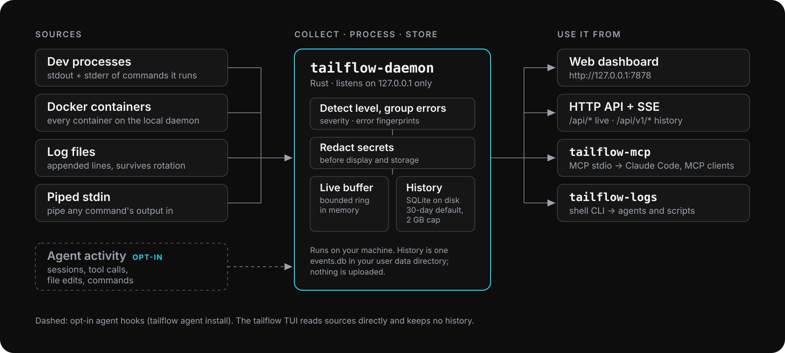
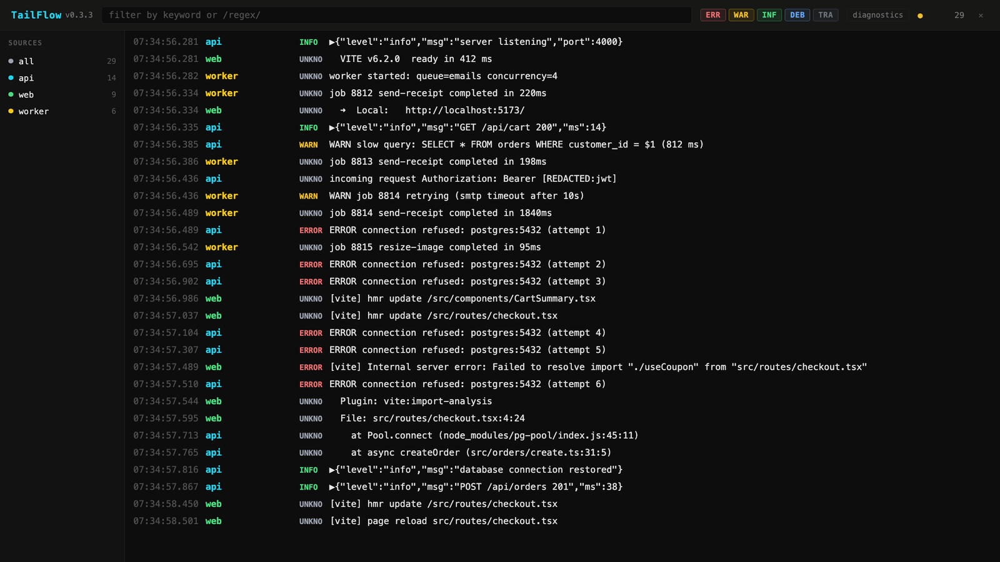

<p align="center">
  
</p>

<p align="center">
  <a href="#features">Features</a> ·
  <a href="#how-it-works">How It Works</a> ·
  <a href="#quick-start">Quick Start</a> ·
  <a href="#documentation">Documentation</a> ·
  <a href="#roadmap">Roadmap</a>
</p>

<p align="center">
  <a href="https://github.com/thinkgrid-labs/tailflow/releases"></a>
  <a href="https://www.npmjs.com/package/tailflow"></a>
  <a href="https://github.com/thinkgrid-labs/tailflow/actions/workflows/ci.yml"></a>
  
  <a href="LICENSE"></a>
</p>

# TailFlow

**Every agent action. One clear timeline.** Local-first observability for AI
coding agents.

## What is TailFlow?

TailFlow collects what your local stack prints — dev servers, Docker containers, and log files — into one
searchable timeline on your machine. Your coding agent reads that timeline
through MCP or a shell command, so it can check that a change actually works
instead of guessing from the source code.

TailFlow is for developers who work with Claude Code and other coding agents on
a local stack. It runs as one small Rust daemon, needs no account, and sends
nothing off your machine.

> [!NOTE]
> Today TailFlow records the **runtime output** of your stack. Recording the
> agent's **own actions** (sessions, tool calls, file edits, commands) is the
> next milestone and is not available yet. See the [roadmap](#roadmap).

## Why TailFlow?

Coding agents edit files, run commands, and restart services on their own. But
a build that passes does not prove the app started, reloaded, or handled a
request. The proof is in the runtime output, spread across terminal tabs,
container logs, and files. An agent cannot see that output, so you copy errors
back into the chat by hand.

TailFlow puts that output in one place that both you and the agent can query:

| Question | Today |
|---|---|
| Did the service start after my agent's change? | Yes — source lifecycle and activity per source |
| What new error appeared after the edit? | Yes — a cursor baseline separates new output from old |
| Is this one failure, or the same crash 400 times? | Yes — errors are grouped by fingerprint with counts |
| When did the error occur, and what came right after it? | Yes — timestamps plus trailing stack-trace context |
| What happened during yesterday's session? | Runtime output only, from durable history (next release) |
| Which files did the agent change? Which commands and tools did it run? | Planned — agent activity collectors |
| How much CPU or memory did that activity use? | Not collected — on the exploring list |

## Features

“Released” means it is in the latest release, v0.3.3. “Next release” means it is
merged on `dev` and ships in the next version.

| Feature | What you get | Status |
|---|---|---|
| **One runtime timeline** | stdout/stderr of dev processes, local Docker containers, log files, and piped stdin, in one ordered stream | Released |
| **Agent access over MCP** | Four bounded tools: `list_log_sources`, `get_recent_errors`, `search_logs`, `wait_for_logs` | Released |
| **Shell CLI** | `tailflow-logs` for agents and scripts without MCP, with JSON output and meaningful exit codes | Released |
| **Error grouping** | Repeated failures collapse into one group with a count and stack-trace context | Released |
| **Wait instead of poll** | Block until a rebuild, error, or any regex appears, without sleep loops | Released |
| **Local dashboard** | Live view at `127.0.0.1:7878` with source counts, severity filters, and regex search | Released |
| **Terminal UI** | `tailflow` for terminal-first live viewing | Released |
| **Guided setup** | `tailflow init` detects dev scripts, Compose files, and log files and writes `tailflow.toml` | Released |
| **Durable local history** | SQLite history with full-text search and cursors that survive restarts (`/api/v1/events`) | Next release |
| **Configurable retention** | 30 days and a 2 GB cap by default, set in `[storage]` | Next release |
| **Secret redaction** | Common credential formats are redacted before display and storage | Next release |
| **Loss reporting** | Every history response says whether it is complete; dropped events are recorded, not hidden | Next release |
| **Lightweight Rust binaries** | Prebuilt binaries via npm or GitHub releases; no Rust toolchain or database server to install | Released |

The [feature guide](docs/features.md) explains each capability and what its
results do and do not prove.

## How it works

<p align="center">
  
</p>

1. **Collect.** `tailflow-daemon` follows the sources in `tailflow.toml` or on
   the command line. It only sees those sources. It does not watch your whole
   machine.
2. **Process.** Each line gets a timestamp, source label, and severity.
   Secrets are redacted, and the line goes into an in-memory buffer and the
   local SQLite history.
3. **Use.** The dashboard, the HTTP API, `tailflow-mcp`, and `tailflow-logs` all
   read from the same daemon, so you and your agent see the same evidence.

The [architecture guide](docs/architecture.md) covers components, invariants,
and the data path in detail.

## Quick start

TailFlow ships prebuilt binaries for macOS (ARM64, x64), Linux (ARM64, x64), and
Windows (x64). The npm package needs Node.js but no Rust toolchain.

```bash
# 1. Install the four commands: tailflow, tailflow-daemon, tailflow-mcp, tailflow-logs
npm install -g tailflow

# 2. In your project, pick sources and write tailflow.toml
cd your-project
tailflow init

# 3. Start the collector, then open http://127.0.0.1:7878
tailflow-daemon
```

Connect Claude Code from another terminal:

```bash
claude mcp add tailflow -- tailflow-mcp
```

Other MCP clients can run `tailflow-mcp` as a stdio server:

```json
{
  "mcpServers": {
    "tailflow": { "command": "tailflow-mcp" }
  }
}
```

Then ask your agent to call `list_log_sources`. It should list your configured
services. For a shell-only check, run `tailflow-logs status`.

Prefer to build from source? With Rust 1.88 or newer:

```bash
git clone https://github.com/thinkgrid-labs/tailflow.git
cd tailflow
cargo install --path crates/tailflow-tui
cargo install --path crates/tailflow-daemon
cargo install --path crates/tailflow-agent
```

The [getting-started guide](docs/getting-started.md) covers manual
configuration, Docker and file sources, custom ports, and troubleshooting.

## Dashboard preview

<p align="center">
  
</p>

<sub>Captured from a local build of <code>dev</code> with synthetic demo services. The bearer token in the <code>api</code> stream was redacted automatically.</sub>

## Privacy and resource use

| Topic | Behavior |
|---|---|
| **Where data lives** | One SQLite file per user: `~/Library/Application Support/tailflow/events.db` (macOS), `~/.local/share/tailflow/events.db` (Linux), `%LOCALAPPDATA%\tailflow\events.db` (Windows). Override with `TAILFLOW_DATA_DIR`, `[storage] path`, or `--db`. |
| **Network** | The daemon listens on `127.0.0.1` only and rejects non-loopback Host headers. TailFlow has no telemetry and no hosted service; nothing is uploaded. |
| **What is collected** | Only the sources you configure: processes it starts, containers on the local Docker daemon, files you name, and piped stdin. |
| **Retention** | `retention_days = 30` and `max_size_mb = 2048` by default in `[storage]`. The size cap always applies, even with `retention_days = "unlimited"`. `--no-storage` keeps everything in memory. |
| **Redaction** | `capture = "metadata"` (the default) redacts common credential formats, such as API keys, bearer tokens, URL passwords, and private keys, before display and storage. Redaction is pattern-based and will not catch every secret. |
| **Overhead** | Measured on a 2018 4-core laptop: idle CPU stays at 0%, and history adds about 35 µs of CPU per stored event, roughly 2% of one core at 100 events/s. See [resource cost](docs/storage.md#resource-cost). |
| **When it runs** | The daemon runs while you keep it open. `tailflow-mcp` runs while your MCP client is connected. `tailflow-logs` exits after each query. |

Durable history, retention, and redaction ship in the next release. Read
[durable history and privacy](docs/storage.md) and
[limitations](docs/limitations.md) before using TailFlow with sensitive logs.
TailFlow has no authentication, so do not expose the daemon to a network.

## Supported coding agents

TailFlow connects to agents in two ways: as an **MCP server** that the agent
calls, or as a **shell CLI** that the agent runs. In both cases the agent reads
your stack's runtime output. TailFlow does not yet instrument the agent itself.

| Agent | How it connects | Status | Recording the agent's own actions |
|---|---|---|---|
| Claude Code | MCP: `claude mcp add tailflow -- tailflow-mcp` | Supported | Planned |
| Codex CLI, Gemini CLI, and other MCP clients | Register `tailflow-mcp` as a stdio MCP server | Experimental: standard MCP, not tested against each client | Planned |
| Any agent with shell access | `tailflow-logs` with `--json` | Supported | Planned |

When agent activity collectors arrive, each event will record its source as
either **agent-reported** (from agent hooks or integrations) or
**filesystem-observed** (watched by TailFlow). The event schema already defines
these fields. No collector writes them yet.

## Roadmap

**Implemented:** runtime collection across processes, Docker, files, and stdin;
MCP and shell access; error grouping; server-side waits; dashboard and TUI;
guided setup; and, on `dev`, durable SQLite history with retention, redaction,
and loss reporting.

**Next:**

- Agent activity collectors (opt-in): sessions, tool calls, file changes, and
  commands, recorded in the existing event schema
- An agent activity view in the dashboard, built on the history API
- A readable query language, such as `agent:claude type:file.modified since:24h`
- “What is failing now that was not failing before?” comparisons against a baseline
- Docker Compose–aware source discovery and container filters
- MCP served directly from the daemon, and optional daemon auto-start

**Exploring:** multi-agent session correlation, git-change correlation,
request and trace correlation, resource usage per session, exports and
diagnostics bundles, and browser-side analysis of history.

None of these are commitments. The [full roadmap](docs/roadmap.md) lists
priorities and non-goals.

## Documentation

| Guide | Contents |
|---|---|
| [Getting started](docs/getting-started.md) | Installation, configuration recipes, and troubleshooting |
| [Features](docs/features.md) | Each capability, its use cases, and what it proves |
| [TailFlow for agents](docs/agents.md) | MCP tools, shell client, workflow patterns, and HTTP API |
| [Architecture](docs/architecture.md) | Components, data flow, and design invariants |
| [Durable history](docs/storage.md) | SQLite history, retention, privacy, and the v1 API |
| [Limitations](docs/limitations.md) | Security, retention, and source boundaries |
| [Roadmap](docs/roadmap.md) | Priorities and explicit non-goals |
| [Changelog](CHANGELOG.md) | Changes by version |

## Contributing

Contributions are welcome. Read [CONTRIBUTING.md](CONTRIBUTING.md) for the
development setup. Please
[open an issue](https://github.com/thinkgrid-labs/tailflow/issues) before you
start a large feature or architectural change. Before opening a pull request,
run:

```bash
cargo fmt --all
cargo clippy --all-targets --all-features -- -D warnings
cargo test --all
```

**Security issues:** please do not include exploit details in a public issue.
Open an issue that asks for a private contact, and a maintainer will follow up.

## License

MIT. See [LICENSE](LICENSE). © 2026 ThinkGrid Labs.
